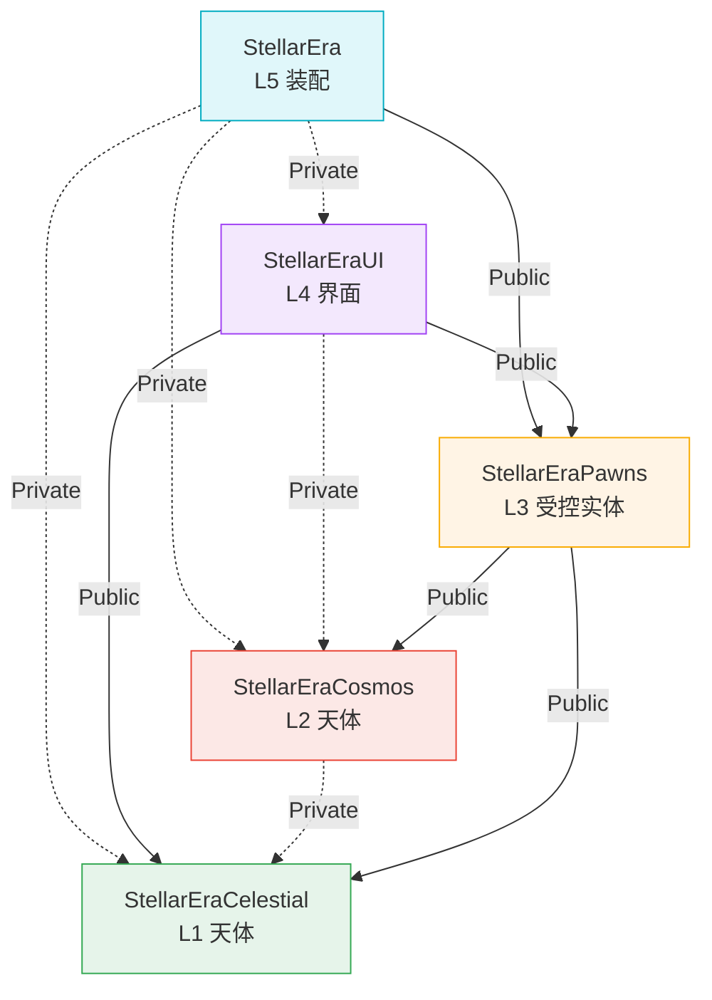

# StellarEra 架构

> 本文描述**已经实施**的架构，不是提案。
> 数字来自 2026-11-28 的源码统计（口径见下），结构改动后请同步本文。
> 体检：`python Tools/check_architecture.py`（加 `--tree` 看分层）。

---

## 一、一页速查

5 个模块，5 层，288 个文件，53053 行，80 个自动化测试文件。

> **统计口径**：文件与行数只数各模块 `Source/<模块>/Src/` 下的 `.h` / `.cpp`
> （递归含子目录，含 `Tests/`），**不含**模块入口 `StellarEra<X>.h/.cpp` 与 `Build.cs`；
> 行数是 `wc -l` 的物理行数。「测试」列只数 `Src/Tests/*Tests.cpp` 文件，
> 同目录的辅助头（如 UI 的 `BlueprintComponentTestHelpers.h`）计入文件数、不计入测试数。
> 汇总句的三个数字 = 下方五行的列合计。

| 层 | 模块 | 文件 | 行数 | 测试 | 一句话 | 依赖（Public / Private） |
|---:|---|---:|---:|---:|---|---|
| L1 | `StellarEraCelestial` | 191 | 33143 | 47 | 天体：`Planet/Src` 的地质管线（Geo 七目录）/ 大气与光照 / 编辑与笔刷 / 体素接线 / 表面射线，`Star/Src` 的恒星组件与参数桥，`Common` 的参数桥基类；地质查看器在 `Planet/Src/Geo/Viewer`（编辑器专属） | Public: Voxel, GeometryCore / Private: AssetRegistry, GeometryFramework, RHI；编辑器目标另加 Slate, SlateCore, InputCore, UnrealEd, WorkspaceMenuStructure, PropertyEditor |
| L2 | `StellarEraCosmos` | 28 | 7322 | 10 | N 体积分与编排、天体类型、轨迹、恒星 Actor | Private: Celestial |
| L3 | `StellarEraPawns` | 48 | 8639 | 13 | 玩家能 possess 的：角色、飞船、星图相机 Pawn（rig / 输入是组件） | Public: Cosmos, Celestial, Voxel / Private: EnhancedInput, InputCore |
| L4 | `StellarEraUI` | 7 | 1394 | 2 | HUD、星图面板 | Public: Celestial, Pawns / Private: Cosmos, Voxel |
| L5 | `StellarEra` | 16 | 2641 | 8 | GameMode、PlayerController、输入动作表聚合（primary game module） | Public: Pawns / Private: UI, Celestial, Cosmos, Voxel, InputCore, EnhancedInput |

**没有 L0 了。** 只剩引擎与 `Voxel` 插件，项目自研代码分五层。

`StellarEra` 保留原名，所以 `IMPLEMENT_PRIMARY_GAME_MODULE` 不动，
`/Script/StellarEra.*` 路径不变，`DefaultEngine.ini` 与 `UniverseMap.umap` 里的引用无需改。

> 模块数在 2026-10-31 定型为 5：`StellarEraCore` 拆掉，N 体求解器并入唯一使用方
> `Cosmos`（`CosmosTypes.h` 跟着走），`IVoxelViewpointInvokers` 落到
> `Celestial/Planet/Src/Invokers/`。更早并进来的 `Minerals/`、`Terrain/`、`Hydrology/` 等目录
> 随后随地质管线重写整体删除，矿物数据现在由 `Celestial/Planet/Src/Geo/` 的配方与矿物目录承载。
> 详细沿革见「十、历史沿革」。

---

## 二、分层与依赖

层号 = 依赖深度，**不是目录**。全部模块平铺在 `Source/` 下。



实线是公开依赖，虚线是私有依赖（下游看不到被依赖模块的头）。

五条 Public 边：`StellarEra → Pawns`、`UI → Celestial`、`UI → Pawns`、
`Pawns → Celestial`、`Pawns → Cosmos`。其中 `StellarEra → Pawns` 是控制器的公开头逼出来的 ——
它 include 了 `StellarEraInputSource.h`（实现 `IStellarEraInputSource`）、`SessionCommands.h`
（实现 `IStellarEraSessionCommands`）与 `Src/Input/StellarEraInputActions.h`（聚合三张 Pawn 表）；
`UI → Pawns` 同理 —— `StarMapUISystem.h` include 了
`StarMapPanelLayout.h`、`StellarEraHUD.h` include 了 `StellarEraNoticeSink.h`，两个头都在 Pawns。
`Pawns → Celestial` 是被 `IVoxelViewpointInvokers` 逼出来的
—— 两个 Pawn 都在**公开头**里继承它；`Pawns → Cosmos` 则因为飞船在公开头里
实现 `ICosmosBody`（2026-11-06 抽出接口后才成立）。
其余跨模块引用一律 Private。

**单向，无环。** 三条曾经试图制造环的路，第一条已经还清，另两条仍按原判据处理：

| 想搬的东西 | 会形成的环 | 现在的处理 |
|---|---|---|
| 星图相机 → Pawns | ~~`Pawns → Cosmos → Pawns`~~（已还清） | 2026-11-06 抽出 `ICosmosBody`（`Cosmos/Src/CosmosBody.h`，由飞船实现）后星图相关类搬进 `Pawns/Src/StarMap/`。现在是「相机 Pawn + 复用 rig」：`AStarMapCameraPawn` 内部挂 `UStarMapRigComponent`，按 M 由控制器生成并 Possess |
| UI 直接用 `CosmosSimulationSubsystem` | 已经是合法方向（UI 在上层），无需搬 | UI 私有依赖 Cosmos |
| `IVoxelViewpointInvokers` 放 Cosmos | `Pawns → Cosmos`，而当时 Cosmos 私有依赖 Pawns | 放 Celestial/Planet/Src/Invokers/，UI 与 Pawns 都已 Public 依赖 Celestial |

### Public 还是 Private —— 判据只有一条

**看公开头**，不看 `.cpp`：

| 公开头里做了什么 | 依赖级别 |
|---|---|
| `#include` 了对方的头 | Public |
| 按值 / 按 `TWeakObjectPtr` 持有对方类型 | Public |
| 继承对方的类（如 `UDataAsset`） | Public |
| 只在 `.cpp` 里用，公开头里连前置声明都没有 | Private |

这条判据踩过坑：模块合并后 UI 失去了一条 Public 传递依赖，链接期才报
`LNK2019: Z_Construct_UClass_UVoxelSimpleInvokerComponent`。**头能编过不代表链接能过**，
UBT 的 Public 依赖是传递的，Private 不是。

---

## 三、模块内布局

除 `StellarEraCelestial` 外，每个模块都是同一种形状：

```
StellarEraXxx/
├── StellarEraXxx.Build.cs           构建规则
├── StellarEraXxx.h / .cpp           模块入口（IMPLEMENT_MODULE）
└── Src/                             业务代码全在这里
    ├── Foo.h / Foo.cpp              头与源同目录并列
    ├── <功能子目录>/                 同样 .h/.cpp 并列
    └── Tests/                       *Tests.cpp 只放这里
```

`StellarEraCelestial` 按**天体**多分一层：

```
StellarEraCelestial/
├── StellarEraCelestial.Build.cs
├── StellarEraCelestial.h / .cpp
├── Planet/
│   ├── Src/    Geo/ Atmosphere/ Edit/ Invokers/ Interaction/ + 行星根级文件
│   └── Tests/
├── Star/
│   ├── Src/    StarBodyComponent / StarBodyChildComponent / StarParamBridge
│   └── Tests/
└── Common/     ChildActorParamBridge（两种天体共用的基类）
```

三条规则：

1. **入口两件套与 `Build.cs` 并排**，不进业务目录。业务目录里只有代码。
2. **`.h` 与 `.cpp` 同目录**，改一个功能时不用两边跳。
3. **新增文件/目录不用登记**：`.cpp` 由 `UBT` 递归收集，include 路径由下面的循环递归添加，
   所以加子目录不需要改 `Build.cs`。唯一例外是**新增模块**，那要动 `Build.cs`、
   `.uproject`、两个 `Target.cs` 的四处。

```csharp
PublicIncludePaths.Add(ModuleDirectory);
foreach (string SubDir in Directory.GetDirectories(ModuleDirectory, "*", SearchOption.AllDirectories))
    PublicIncludePaths.Add(SubDir);
```

`BuildSettingsVersion.V7` 下 `bLegacyPublicIncludePaths = false`，UBT **只认**
`Public/Private/Classes/Internal` 这四个目录名自动加路径（`UEBuildModuleCPP.cs:450-474`），
其它目录必须像上面这样显式加，否则 `#include "PlanetCharacter.h"` 立刻 C1083。

### 什么时候该建子目录

| 目录内文件数 | 动作 |
|---|---|
| ≤ 12 | 不拆。命名前缀（`PlanetMineral*`）已经够用 |
| 13–15 | 先问「有没有第二类职责」，有才拆 |
| ≥ 16 | 已过载，拆 |

拆分方式：**按「它回答什么问题」分，不按类名分**；拆完每族至少 4 个文件才值得单独开目录。

判归属**看 include 关系，不看文件名前缀**。例证：`Invokers/` 的 6 个文件是 Voxel 插件
LOD 的接线层，被 Pawns 与 UI 跨模块 include，所以单独成目录，不混进 `Atmosphere/`。

当前各目录规模（只数目录内直接文件；Celestial 的相对路径从 `Planet/Src/` 起）：
`Geo/Bake` 14、`Geo/Core` 12、`Geo/Snapshot` 11、
`Geo/Debug` 10、`Geo/Voxel` 7、`Geo/Assets` 6、`Geo/Viewer` 5、`Invokers` 6、
`Atmosphere` 4（+ `Lighting` 5 / `Params` 5 / `Sky` 5 / `Material` 1）、
`Edit` 2（+ `Brush` 4 / `Progressive` 4 / `UI` 4）、`Interaction` 2。
`Cosmos/Src/NBody` 5、`Cosmos/Src/Trajectory` 6。
Pawns 的三个功能面各自再分出 `Input/`：`Character` 4（+ `Animations` 2 / `Input` 4）、
`Spaceship` 4（+ `Input` 4）、`StarMap` 8（+ `Input` 4）。

`Atmosphere/Sky/`（5 个文件）是天空与恒星材质构建器的落点，不是大气参数的一部分；
`Atmosphere/Material/` 只有 1 个文件，保留是因为它只服务大气壳的材质。

`Cosmos/Src/NBody/` 是个例外：只有 5 个文件（`NBodySimulator` / `NBodyIntegration` +
`CosmosTypes.h`），够不上「每族 ≥4 个」的门槛，但它是一个独立计算单元，与编排层没有
代码交集 —— 判据的第二条「有没有第二类职责」在这里成立，所以还是分了出来。
`Pawns/Src/StarMap/` 共 12 个文件：相机 Pawn（`AStarMapCameraPawn`，内部挂
`UStarMapRigComponent`）、绘制与命中共用的纯几何（`StarMapPanelLayout` / `StarMapPicking`），
以及 `Input/`（`UStarMapInputComponent` + 动作表）。它们是一个功能族（星图视点），
不受这条门槛约束。

### 地质管线的层次（`Celestial/Planet/Src/Geo/`）

数据单向流动：**配方 → 烘焙阶段 → 快照 → 体素 / 材质**。

```
Geo/
├── Assets/     配方与目录：UPlanetRecipe（DA_GeoRecipe_*）、矿物目录、散布器
├── Bake/       阶段管线：IPlanetStage 子类按阶段号执行，产出字段
├── Core/       字段、岩性、矿物、噪声、图元（纯数据与纯函数）
├── Snapshot/   烘焙快照：序列化、缓存、材质 / 形状求值核
├── Voxel/      体素适配器（UPlanetGeoGenerator）与材质构建器
├── Viewer/     Slate 查看器（整份 #if WITH_EDITOR）
└── Debug/      调试图层、诊断渲染、biome cubemap
```

这是全项目唯一的三级域（`Src/Geo/<子目录>/文件`），`Geo/` 本身不放文件。
阶段只声明自己读写的字段与调试图层，查看器与渲染按注册表工作，**新阶段不需要改它们**。

### 搬目录为什么可以零代码改动

同时满足这两条时，搬子目录只需 `git mv` + 重编：

1. 全项目 include 都是**扁平写法**（`#include "PlanetSurfaceRay.h"`，不带目录前缀）
2. `Build.cs` 递归加 include 路径

2026-10-31 那次搬 18 个文件，git 全部识别为 `rename (100%)`，无一行内容变化。

---

## 四、通讯机制

只有三种通道，**没有事件总线**，也**刻意不引入**。

### 通道一：Pull —— HUD 每帧拉

UI 是 **Canvas 立即模式**（`AStellarEraHUD::DrawHUD` + `UStarMapUISystem` 全静态无状态绘制），
不是 UMG。所以按帧拉取，不做数据绑定：

```cpp
UCosmosSimulationSubsystem* Simulation =
    World ? World->GetSubsystem<UCosmosSimulationSubsystem>() : nullptr;
```

`UStarMapUISystem` 的方法全是 `static`，只吃参数、不持有状态 —— 因此它天然可测
（`Src/Tests/` 里直接调）。

> UMG 面板将来如果出现（工厂界面），那个局部可以上 MVVM。全局不适用。

### 通道二：Subsystem —— 跨帧状态的唯一归属

全项目**只有一个** Subsystem：`UCosmosSimulationSubsystem`（`UTickableWorldSubsystem`，
在 `StellarEraCosmos/Src/`）。

规则：**同一份状态活过两帧，就必须有唯一归属地。** 不许出现「A 组件缓存一份、B 组件也缓存一份」。

### 通道三：局部委托 —— 只用于「资产变更」这种低频通知

全项目只有 2 个：

| 委托 | 位置 | 用途 |
|---|---|---|
| `FGeoBakeStartedEvent` / `FGeoBakeFinishedEvent` | `StellarEraCelestial/Planet/Src/VoxelPlanetActor.h` | 后台地质烘焙开始 / 完成（成功、耗时），查看器与细节面板订阅 |

都是编辑器里改资产时的刷新信号，不是运行时游戏逻辑的消息。

### 接口 —— 打破「实现方 ↔ 使用方」的互相依赖

| 接口 | 位置 | 实现方 / 为什么放这 |
|---|---|---|
| `IVoxelViewpointInvokers` | `StellarEraCelestial/Planet/Src/Invokers/` | 实现方是 Pawns 的两个 Pawn（角色、飞船），使用方是 Controller。三方都已依赖 Celestial，放这里不需要任何新依赖 |
| `ICosmosBody` | `StellarEraCosmos/Src/CosmosBody.h` | 实现方是 `ASpaceshipPawn`（13 个纯虚）。Cosmos 是消费方且在低层（L2），放在 Cosmos 才不会让 `Pawns → Cosmos` 反向 |

另外三条接口同理，只是不在跨层主路径上：`IStellarEraInputSource`（`Pawns/Src/StellarEraInputSource.h`，
Controller 实现，Pawn 用它取自己那张动作表）、`IStellarEraNoticeSink`（`Pawns/Src/StellarEraNoticeSink.h`，
HUD 实现，Pawn 用它弹提示）与 `IStellarEraSessionCommands`（`Pawns/Src/SessionCommands.h`，
Controller 实现，Pawn 按键后用它要求切星图 / 上下船）。

接口的去处遵循同一条判据：**契约跟着「已经被所有人依赖的那一层」走**。
`IVoxelViewpointInvokers` 的四方都依赖 Celestial（体素接线层在那里），所以住 Planet；
`ICosmosBody` 反过来 —— 消费方 Cosmos 在低层，所以契约跟着 Cosmos 走，由上层 Pawns 实现。

原先 `IVoxelViewpointInvokers` 住在 `StellarEraCore/Src/Interfaces/` —— 那是「谁都不依赖」
时的正确答案。Core 拆掉后 Planet 成了那个位置。

### 明确禁止

| 禁止 | 原因 |
|---|---|
| 事件总线 / 全局消息队列 | 单人项目，订阅关系一多就没人理得清；Pull 已经够用 |
| 全局单例 | Subsystem 就是 UE 给的单例，且带生命周期 |
| 功能模块 include UI 的头 | 反向依赖，`StellarEraUI.Build.cs` 头注释里写死了 |
| UI 依赖 `StellarEra`（primary game module） | Game 依赖 UI，UI 再依赖 Game 成环。鼠标坐标 / 屏幕拾取直接吃 `APlayerController` |

### 输入绑定：谁被操控谁绑

角色 / 飞船各有自己的输入组件；星图的 `UStarMapInputComponent` 挂在两者身上。
Pawn 的 `SetupPlayerInputComponent` 只做转发（`PlayerInput->Bind(InputComponent)`），
回调本身不住在 Pawn 类里：

| 可操控对象 | 输入组件 | 绑什么 |
|---|---|---|
| `APlanetCharacter` | `UPlanetCharacterInputComponent`（`Pawns/Src/Character/Input/`） | 移动、视角、跳跃、冲刺、缩放、右键点放 + E（登船）/ 左键（编辑模式挖掘） |
| `ASpaceshipPawn` | `USpaceshipInputComponent`（`Pawns/Src/Spaceship/Input/`） | 视角、推力、滚转、升降、加速、巡航、调试视角、缩放 + E（离船） |
| 星图（挂在两个 Pawn 上） | `UStarMapInputComponent`（`Pawns/Src/StarMap/Input/`） | 星图视角（绕行 / 转头）、缩放、编辑（G）与笔刷尺寸、左键选择 / 拖拽、M（进出星图） |

`AStellarEraPlayerController` **一条动作都不绑**（`SetupInputComponent` 已删除）。星图不换
Possess：M 由 `UStarMapInputComponent` 在当前被 Possess 的 Pawn 上绑一次，只切
`UStarMapRigComponent` 的状态。E / M / 左键在每张需要它的表里各有一条动作，**语义**由各
Pawn 决定（同一个 E：角色登船、飞船离船），动作执行则经 `IStellarEraSessionCommands`
回到控制器。
星图的分派规则（`EStarMapLookMode`）与 `UStarMapInputComponent::ResolveLookMode` 都放在
`StarMap/Input/StarMapInputComponent.h` —— 星图的鼠标位移属于星图输入组件，不属于控制器。

动作表由控制器经 `IStellarEraInputSource` 交给 Pawn，所以控制器里没有按 Pawn 类型分派的
`Cast`；新增一种可操控 Pawn 只需给它配一个 `*InputComponent`。

---

## 五、契约放在哪

| 东西 | 放哪 | 例 |
|---|---|---|
| 跨模块接口 | 已被所有实现方/使用方依赖的最低层 | `IVoxelViewpointInvokers` → `Celestial/Planet/Src/Invokers/` |
| 天体与单位类型 | `StellarEraCosmos/Src/` | `CosmosTypes.h` |
| 使用方专属契约 | 使用方模块根 | `StellarEraPawns/Src/StellarEraInputSource.h` |
| UE 资产预设 | 定义它的数据模块 | `UPlanetRecipe` 在 `Celestial/Planet/Src/Geo/Assets/` |
| 内部头（有实现细节） | 与实现同目录 | `PlanetProgressiveEditKernel.h` |

---

## 六、命名与导出

| 对象 | 规则 | 例 |
|---|---|---|
| 导出宏 | `<模块名大写>_API`，**与当前模块名一致** | `STELLARERAPLANET_API` |
| UCLASS | `U` / `A` / `F` / `I` 前缀 + 业务名 | `UPlanetGeoGenerator` |
| 文件名 | 与主类同名，不加模块前缀以外的修饰 | `PlanetEditComponent.h` |
| 测试 | `*Tests.cpp`，类名 `F<被测>` + `Test` | `FPlanetSurfaceRayTest` |

> **导出宏最容易漏的地方**：模块合并后，从主线并进来的新代码常常还写着旧模块的
> `_API`（如 `STELLARERAPLANETEDIT_API`）。文件路径会被 git rename detection 带走，
> **宏不会**。合并后必须 `grep` 一遍旧模块名。

---

## 七、新增功能落位决策树

```
新代码要加在哪？
│
├─ 是「地质生成规则」？                  → Celestial/Planet/Src/Geo/（新阶段进 Bake/，配方进 Assets/）
├─ 是「行星上的东西」（大气/编辑/体素接线）？
│                                       → StellarEraCelestial/Planet/Src/<功能面>/
├─ 是「玩家能控制的东西」？              → StellarEraPawns/Src/<Character|Spaceship|StarMap>/
├─ 是「天体运动 / 轨道 / N 体」？        → StellarEraCosmos
├─ 是「显示 / 交互」？                   → StellarEraUI
├─ 是「游戏框架 / 模式切换 / 会话命令实现」？ → StellarEra（装配层）
├─ 是「某个 Pawn 的输入响应」？           → 该 Pawn 目录下的 `Input/*InputComponent`
└─ 是「跨模块契约」？
   ├─ 接口                             → 已被三方依赖的最低层（现为 Celestial/Planet/Src/Invokers/）
   └─ 天体 / 单位 POD                    → StellarEraCosmos/Src/
```

新模块**不要轻易加**。单人项目里模块化的收益（并行开发、二进制复用、流式加载）
接近零，成本（Build.cs 维护、环排查、跨模块 include 的隐性约束、导航时多找一层）
每天都要付。

---

## 八、红线

1. `*Tests.cpp` **只能出现在 `Src/Tests/`**。测试放哪个模块看它 include 了谁 ——
   必须是所引头文件的下游。跨模块集成测试放 `StellarEra/Src/Tests/`。
2. **不许往 `Src/` 根堆文件**。那一层只留模块门面（如 `VoxelPlanetActor.h`）。
3. **不许出现依赖环**。想搬某个类而产生环时，先抽接口，不要硬搬。
4. **`Config/DefaultEngine.ini` 的 `[CoreRedirects]` 不要删**。53 条历史类路径靠它兜底
   （43 Class / 6 Enum / 2 Property / 2 Struct），删了蓝图父类和 `.umap` 里的引用会断。
5. **`Plugins/VoxelFree` 与 `Plugins/VibeUE` 是第三方，不要改。**

---

## 九、构建与验证

```bash
# 编译（编辑器必须先关；不要用 Build.bat，见 CLAUDE.md）
"D:/Application/Epic Games/UE_5.8/Engine/Binaries/ThirdParty/DotNet/10.0/win-x64/dotnet.exe" \
  "D:/Application/Epic Games/UE_5.8/Engine/Binaries/DotNET/UnrealBuildTool/UnrealBuildTool.dll" \
  StellarEraEditor Win64 Development \
  -Project="F:/workspace/ue/StellarEra/StellarEra.uproject" -WaitMutex -FromMsBuild

# 架构体检
python Tools/check_architecture.py
python Tools/check_architecture.py --tree
```

体检覆盖：依赖环、超大文件、跨模块 include ≥6、测试是否散落、纯逻辑模块是否暴露表现层基类。

**当前基线（2026-11-28）**：依赖环 / 测试散落 / 跨模块 include ≥6 / 分层倒挂 —— **全空**。
只有体积信号：14 个 `.cpp` 超 600 行、7 个 `.h` 超 300 行，
属于体积提示、不是违规：`SpaceshipPawn.h` 866 行是因为它的属性配置段本来就长。

本机的 `LNK1201 / LNK1136` 是安全软件拦 `Binaries/` 目录写入导致的，
必须做 `Binaries → BinariesReal` 目录联接。步骤记在 `docs/BUILD_NOTES.md`。

---

## 十、历史沿革

| 时间 | 变化 | 记录 |
|---|---|---|
| 重构前 | 11 模块、8 层，测试散在各模块 `Private/` | — |
| 2026-10-31 | **11 → 7 合并**：Terrain+Atmosphere+Minerals+PlanetEdit → Planet；Character+Spaceship → Pawns | 推演记录已随 2026-11-28 文档清理删除 |
| 同日 | 取消 `Public/Private` 分层，改为 `Src/` 内头源同目录 | 同上 |
| 同日 | 并入主线在此期间开发的 8 个行星编辑提交（git 重命名检测全自动映射） | 提交 `3c016bd` |
| 同日 | 过载目录细分：`Terrain` 18 → 10/4/4，Geology 拆 `Distributions/` | 提交 `967135a` |
| 同日 | 主线切到 `master` 并首次推送远程（361 提交 + 180MB LFS） | `aaf0bfc` |
| 同日 | **7 → 6 合并**：整个 `StellarEraGeology` 并入 `Celestial/Planet/Src/Minerals/`，矿物成为完整目录（该目录后来随地质管线重写整体删除） | 本文三之「地质管线的层次」 |
| 同日 | **6 → 5 拆分**：`StellarEraCore` 拆掉。N 体求解器 + `CosmosTypes` 并入 Cosmos（唯一使用方），`IVoxelViewpointInvokers` 进 `Celestial/Planet/Src/Invokers/`。项目自研代码不再有 L0 | 本文一、二 |
| 2026-11-06 | 星图相机搬进 `Pawns/Src/StarMap/`（Cosmos 抽出 `ICosmosBody`）；动作表按 Pawn 拆成三张，控制器不再绑任何输入 | 本文二、四 |
| 2026-11-19 | 删除星图相机类：`UStarMapRigComponent` 挂在飞船 / 角色上接管相机，`UStarMapInputComponent` 同理；进出星图不再换 Possess | 本文二、四 |
| 同日 | 输入文件归拢到 `Character|Spaceship|StarMap/Input/` 与 `StellarEra/Src/Input/`；`PlanetEditUI` 从 UI 搬进 `Celestial/Planet/Src/Edit/`；`StarMapPanelLayout` / `StarMapPicking` 抽成 Pawns 里的纯几何 | 本文三 |
| 2026-11-26 | 星图改回**相机 Pawn + 复用 rig**：按 M 由控制器找最近天体、生成并 Possess `AStarMapCameraPawn`，退图 Possess 回源 Pawn；飞船 / 角色不再挂 rig，编辑组件与退场相机从源 Pawn 取 | 本文二、四 |
| 2026-11-28 | 模块改名 **`StellarEraPlanet` → `StellarEraCelestial`**（天体），内部按天体分 `Planet/Src`、`Star/Src` 与 `Common/`；导出宏随之改为 `STELLARERACELESTIAL_API` | 本文一、三 |

17 模块方案与 11 → 7 合并的推演记录已在 2026-11-28 清理中删除（见提交历史）；
**不要按任何旧文档实现目录结构**，以本文为准。

---

## 相关文档

| 文档 | 内容 |
|---|---|
| `Source/README.md` | 按层导读 + 「改 X 看哪个文件」索引（最常翻） |
| `CLAUDE.md` | 给 AI 助手看的模块结构与硬规则 |
| `docs/BUILD_NOTES.md` | 本机构建坑（pdb 写入失败、UBA） |
| `docs/DEV_RULES.md` | 编码与工作规范 |
| `docs/memory/` | 历史踩坑与项目记忆（构建工具链 / 引擎坑 / 项目状态） |
| `docs/superpowers/specs/` | 功能设计规格 |
