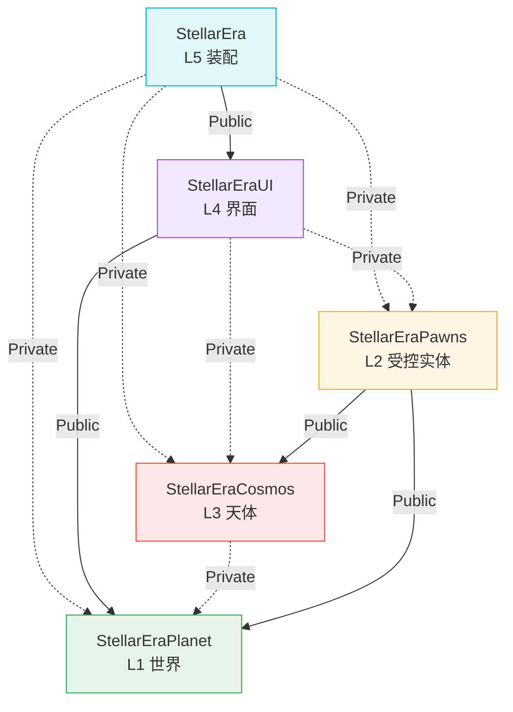

# StellarEra 架构

> 本文描述**已经实施**的架构，不是提案。
> 数字来自 2026-11-06 的源码统计（口径见下），结构改动后请同步本文。
> 体检：`python Tools/check_architecture.py`（加 `--tree` 看分层）。

---

## 一、一页速查

5 个模块，5 层，187 个文件，51307 行，54 个自动化测试文件。

> **统计口径**：文件与行数只数各模块 `Source/<模块>/Src/` 下的 `.h` / `.cpp`
> （递归含子目录，含 `Tests/`），**不含**模块入口 `StellarEra<X>.h/.cpp` 与 `Build.cs`；
> 行数是 `wc -l` 的物理行数。「测试」列只数 `Src/Tests/*Tests.cpp` 文件，
> 同目录的辅助头（如 UI 的 `BlueprintComponentTestHelpers.h`）计入文件数、不计入测试数。
> 汇总句的三个数字 = 下方五行的列合计。

| 层 | 模块 | 文件 | 行数 | 测试 | 一句话 | 依赖（Public / Private） |
|---:|---|---:|---:|---:|---|---|
| L1 | `StellarEraPlanet` | 120 | 29190 | 30 | 一颗行星的全部：地形 / 大气 / 矿物（含地质场）/ 编辑 / 体素接线 | Public: Voxel, GeometryCore / Private: AssetRegistry, GeometryFramework |
| L2 | `StellarEraPawns` | 29 | 7492 | 10 | 玩家能 possess 的：角色、飞船、星图相机 | Public: Cosmos, Planet, Voxel / Private: EnhancedInput, InputCore |
| L3 | `StellarEraCosmos` | 18 | 7739 | 6 | N 体积分与编排、天体类型、轨迹 | Private: Planet |
| L4 | `StellarEraUI` | 12 | 3133 | 4 | HUD、星图、图例 | Public: Planet / Private: Pawns, Cosmos, Voxel |
| L5 | `StellarEra` | 8 | 3753 | 4 | GameMode、PlayerController（primary game module） | Public: UI / Private: Planet, Pawns, Cosmos, Voxel, InputCore, EnhancedInput |

**没有 L0 了。** 只剩引擎与 `Voxel` 插件，项目自研代码分五层。

`StellarEra` 保留原名，所以 `IMPLEMENT_PRIMARY_GAME_MODULE` 不动，
`/Script/StellarEra.*` 路径不变，`DefaultEngine.ini` 与 `UniverseMap.umap` 里的引用无需改。

> **2026-10-31 两次合并**：
> ① 原 `StellarEraGeology`（18 文件 3175 行）整个并入 `Planet/Src/Minerals/` ——
>    它不是地形辅助，而是矿物域的数据层，被 Terrain（矿囊参与密度场）与
>    Minerals（着色与开采）同时消费。模块 7 → 6。
> ② 原 `StellarEraCore`（7 文件 2687 行）拆掉 —— 其中 2411 行是 N 体求解器，
>    剩一个枚举头和一个接口头。求解器并入它唯一的使用方 `Cosmos`，
>    `CosmosTypes.h` 跟着走，`IVoxelViewpointInvokers` 落到
>    `Planet/Src/Invokers/`（体素接线层）。模块 6 → 5。

---

## 二、分层与依赖

层号 = 依赖深度，**不是目录**。全部模块平铺在 `Source/` 下。



实线是公开依赖，虚线是私有依赖（下游看不到被依赖模块的头）。

四条 Public 边：`StellarEra → UI`、`UI → Planet`、`Pawns → Planet`、`Pawns → Cosmos`。
其中 `Pawns → Planet` 是被 `IVoxelViewpointInvokers` 逼出来的 —— 两个 Pawn 与星图相机
都在**公开头**里继承它；`Pawns → Cosmos` 则因为飞船在公开头里实现 `ICosmosBody`、
星图相机要调 `UCosmosSimulationSubsystem`（2026-11-06 抽出接口后才成立）。
其余跨模块引用一律 Private。

**单向，无环。** 三条曾经试图制造环的路，第一条已经还清，另两条仍按原判据处理：

| 想搬的东西 | 会形成的环 | 现在的处理 |
|---|---|---|
| `AStarMapCameraPawn` → Pawns | ~~`Pawns → Cosmos → Pawns`~~（已还清） | 2026-11-06 抽出 `ICosmosBody`（`Cosmos/Src/CosmosBody.h`，由飞船实现）后相机已搬进 `Pawns/Src/StarMap/`，旧脚本路径由 `[CoreRedirects]` 兜底 |
| UI 直接用 `CosmosSimulationSubsystem` | 已经是合法方向（UI 在上层），无需搬 | UI 私有依赖 Cosmos |
| `IVoxelViewpointInvokers` 放 Cosmos | `Pawns → Cosmos`，而当时 Cosmos 私有依赖 Pawns | 放 Planet/Src/Invokers/，UI 与 Pawns 都已 Public 依赖 Planet |

### Public 还是 Private —— 判据只有一条

**看公开头**，不看 `.cpp`：

| 公开头里做了什么 | 依赖级别 |
|---|---|
| `#include` 了对方的头 | Public |
| 按值 / 按 `TWeakObjectPtr` 持有对方类型 | Public |
| 继承对方的类（如 `UDataAsset`） | Public |
| 只在 `.cpp` 里用，公开头里连前置声明都没有 | Private |

这条判据踩过坑：合并后 UI 失去了 Terrain 的 Public 传递依赖，链接期才报
`LNK2019: Z_Construct_UClass_UVoxelSimpleInvokerComponent`。**头能编过不代表链接能过**，
UBT 的 Public 依赖是传递的，Private 不是。

---

## 三、模块内布局

每个模块长得一模一样，只有四种东西：

```
StellarEraPlanet/
├── StellarEraPlanet.Build.cs       构建规则
├── StellarEraPlanet.h              模块入口（IMPLEMENT_MODULE）
├── StellarEraPlanet.cpp
└── Src/                            业务代码全在这里
    ├── VoxelPlanetActor.h/.cpp     头与源同目录并列
    ├── Terrain/  Surface/  Invokers/  Atmosphere/  Minerals/  Edit/
    └── Tests/                      *Tests.cpp 只放这里
```

三条规则：

1. **入口两件套与 `Build.cs` 并排**，不进 `Src/`。`Src/` 里只有业务代码。
2. **`.h` 与 `.cpp` 同目录**，改一个功能时不用两边跳。
3. **新增文件/目录不用登记**：`.cpp` 由 `UBT` 递归收集，include 路径由下面的循环递归添加，
   所以加子目录不需要改 `Build.cs`。唯一例外是**新增模块**，那要动 `Build.cs`、
   `.uproject`、两个 `Target.cs` 的四处。

```csharp
string SrcDir = Path.Combine(ModuleDirectory, "Src");
PublicIncludePaths.Add(ModuleDirectory);
PublicIncludePaths.Add(SrcDir);
foreach (string SubDir in Directory.GetDirectories(SrcDir, "*", SearchOption.AllDirectories))
    PublicIncludePaths.Add(SubDir);
```

`BuildSettingsVersion.V7` 下 `bLegacyPublicIncludePaths = false`，UBT **只认**
`Public/Private/Classes/Internal` 这四个目录名自动加路径（`UEBuildModuleCPP.cs:450-474`），
`Src/` 及子目录必须像上面这样显式加，否则 `#include "PlanetCharacter.h"` 立刻 C1083。

### 什么时候该建子目录

| 目录内文件数 | 动作 |
|---|---|
| ≤ 12 | 不拆。命名前缀（`PlanetMineral*`）已经够用 |
| 13–15 | 先问「有没有第二类职责」，有才拆 |
| ≥ 16 | 已过载，拆 |

拆分方式：**按「它回答什么问题」分，不按类名分**；拆完每族至少 4 个文件才值得单独开目录。

判归属**看 include 关系，不看文件名前缀**。例证：`Terrain/` 原来 18 个文件，
其中 4 个被 Pawns 与 UI 跨模块 include —— 它们是 Voxel 插件 LOD 的接线层，
不是地形，于是分出了 `Invokers/`。

当前各目录规模：`Terrain` 10、`Edit` 12、`Atmosphere` 12、`Hydrology` 6、`Invokers` 5、
`Surface` 4、`Cosmos/Src` 9（+ `NBody` 3）、`UI/Src` 7、`Character` 8、`Spaceship` 6、
`StarMap` 2、`StellarEra/Src` 4。
`Minerals/` 拆成三个子目录，其中 `Geology/` 再分出 `Distributions/`：
`Geology` 5（+ `Distributions` 10）、`Surface` 4、`View` 12。

`Cosmos/Src/NBody/` 是个例外：只有 3 个文件（`NBodySimulator.h/.cpp` + `CosmosTypes.h`），
够不上「每族 ≥4 个」的门槛，但它是一个 1300 行的独立计算单元，且与编排层没有代码交集 ——
判据的第二条「有没有第二类职责」在这里成立，所以还是分了出来。
`Pawns/Src/StarMap/` 同理只有 2 个文件：它是 2026-11-06 整体搬来的单个类（星图相机），
不是从某个目录里拆出来的功能族，因此不受这条门槛约束。

### 矿物域的层次（`Planet/Src/Minerals/`）

`StellarEraGeology` 并入后，矿物是一个完整目录，内部按「数据 → 形态 → 表面 → 视图」分：

```
Minerals/
├── Geology/                 元素表、地质场、UDataAsset 预设  数据：有什么、多少
│   └── Distributions/       基类 + 囊状/脉状/片层/浸染四变体  形态：什么形状
├── Surface/                 矿物表面几何、材质构建          外观：怎么显示
└── View/                    观测 Actor 与组件               交互：怎么看、怎么选
```

`Distributions/` 放在 `Geology/` 里面而不是与它平级：分布是地质数据的**形态参数**，
`PlanetGeologyField` 建运行时索引时直接消费它们，两者是一份数据的两面。
这是全项目唯一的三级嵌套（`Src/Minerals/Geology/Distributions/`）。

它不单独成模块的原因：`PlanetGeologyField` 必须 include `PlanetGeologyDistribution`，
独立成模块会让 Geology 反过来依赖 Planet，与 Planet 已有的依赖构成**模块环**，
UBT 直接报 circular dependency。数据与形态在同一模块内，环就消失了。

### 搬目录为什么可以零代码改动

同时满足这两条时，搬子目录只需 `git mv` + 重编：

1. 全项目 include 都是**扁平写法**（`#include "PlanetSurfaceRay.h"`，不带目录前缀）
2. `Build.cs` 递归加 include 路径

2026-10-31 那次搬 18 个文件，git 全部识别为 `rename (100%)`，无一行内容变化。

---

## 四、通讯机制

只有三种通道，**没有事件总线**，也**刻意不引入**。

### 通道一：Pull —— HUD 每帧拉

UI 是 **Canvas 立即模式**（`AStellarEraHUD::DrawHUD` + `UStarMapUISystem` 全静态无状态绘制），
不是 UMG。所以按帧拉取，不做数据绑定：

```cpp
UCosmosSimulationSubsystem* Simulation =
    World ? World->GetSubsystem<UCosmosSimulationSubsystem>() : nullptr;
```

`UStarMapUISystem` 的方法全是 `static`，只吃参数、不持有状态 —— 因此它天然可测
（`Src/Tests/` 里直接调）。

> UMG 面板将来如果出现（工厂界面），那个局部可以上 MVVM。全局不适用。

### 通道二：Subsystem —— 跨帧状态的唯一归属

全项目**只有一个** Subsystem：`UCosmosSimulationSubsystem`（`UTickableWorldSubsystem`，
在 `StellarEraCosmos/Src/`）。

规则：**同一份状态活过两帧，就必须有唯一归属地。** 不许出现「A 组件缓存一份、B 组件也缓存一份」。

### 通道三：局部委托 —— 只用于「资产变更」这种低频通知

全项目只有 2 个：

| 委托 | 位置 | 用途 |
|---|---|---|
| `FOnPlanetGeologyPresetChanged` | `StellarEraPlanet/Src/Minerals/Geology/PlanetGeologyPreset.h` | 预设资产被改 |
| `FOnPlanetGeologyAssetChanged` | `StellarEraPlanet/Src/VoxelPlanetActor.h` | 行星引用的地质资产被换 |

都是编辑器里改资产时的刷新信号，不是运行时游戏逻辑的消息。

### 两个接口 —— 打破「实现方 ↔ 使用方」的互相依赖

| 接口 | 位置 | 为什么放这 |
|---|---|---|
| `IVoxelViewpointInvokers` | `StellarEraPlanet/Src/Invokers/` | 实现方是 Pawns 的两个 Pawn 与星图相机（2026-11-06 起相机也在 `Pawns/Src/StarMap/`），使用方是 Controller。三方都已依赖 Planet，放这里不需要任何新依赖 |
| `IStarMapUIInputs` | `StellarEraUI/Src/` | 明确属于 UI 的使用方契约，由 Controller（L5）实现 |

两个接口的去处遵循同一条判据：**契约跟着「已经被所有人依赖的那一层」走**。
`IVoxelViewpointInvokers` 的四方都依赖 Planet（体素接线层在那里），所以住 Planet；
`IStarMapUIInputs` 是 UI 的输入需求，所以住 UI。

原先 `IVoxelViewpointInvokers` 住在 `StellarEraCore/Src/Interfaces/` —— 那是「谁都不依赖」
时的正确答案。Core 拆掉后 Planet 成了那个位置。

### 明确禁止

| 禁止 | 原因 |
|---|---|
| 事件总线 / 全局消息队列 | 单人项目，订阅关系一多就没人理得清；Pull 已经够用 |
| 全局单例 | Subsystem 就是 UE 给的单例，且带生命周期 |
| 功能模块 include UI 的头 | 反向依赖，`StellarEraUI.Build.cs` 头注释里写死了 |
| UI 依赖 `StellarEra`（primary game module） | Game 依赖 UI，UI 再依赖 Game 成环。要控制器数据就走 `IStarMapUIInputs` |

---

## 五、契约放在哪

| 东西 | 放哪 | 例 |
|---|---|---|
| 跨模块接口 | 已被所有实现方/使用方依赖的最低层 | `IVoxelViewpointInvokers` → `Planet/Src/Invokers/` |
| 天体与单位类型 | `StellarEraCosmos/Src/` | `CosmosTypes.h` |
| 使用方专属契约 | 使用方模块根 | `StellarEraUI/Src/StarMapUIInputs.h` |
| UE 资产预设 | 定义它的数据模块 | `UPlanetGeologyPreset` 在 `Minerals/Geology/` |
| 内部头（有实现细节） | 与实现同目录 | `PlanetProgressiveEditKernel.h` |

---

## 六、命名与导出

| 对象 | 规则 | 例 |
|---|---|---|
| 导出宏 | `<模块名大写>_API`，**与当前模块名一致** | `STELLARERAPLANET_API` |
| UCLASS | `U` / `A` / `F` / `I` 前缀 + 业务名 | `UVoxelPlanetGenerator` |
| 文件名 | 与主类同名，不加模块前缀以外的修饰 | `PlanetEditComponent.h` |
| 测试 | `*Tests.cpp`，类名 `F<被测>` + `Test` | `FPlanetSurfaceRayTest` |

> **导出宏最容易漏的地方**：模块合并后，从主线并进来的新代码常常还写着旧模块的
> `_API`（如 `STELLARERAPLANETEDIT_API`）。文件路径会被 git rename detection 带走，
> **宏不会**。合并后必须 `grep` 一遍旧模块名。

---

## 七、新增功能落位决策树

```
新代码要加在哪？
│
├─ 是「元素/矿物分布规则」？            → Planet/Src/Minerals/Geology/（形态放 Distributions/）
├─ 是「行星上的东西」（地形/大气/矿物/编辑/表面）？
│                                       → StellarEraPlanet/Src/<功能面>/
├─ 是「玩家能控制的东西」？              → StellarEraPawns/Src/<Character|Spaceship|StarMap>/
├─ 是「天体运动 / 轨道 / N 体」？        → StellarEraCosmos
├─ 是「显示 / 交互」？                   → StellarEraUI
├─ 是「游戏框架 / 输入绑定 / 模式切换」？  → StellarEra（装配层）
└─ 是「跨模块契约」？
   ├─ 接口                             → 已被三方依赖的最低层（现为 Planet/Src/Invokers/）
   └─ 天体 / 单位 POD                    → StellarEraCosmos/Src/
```

新模块**不要轻易加**。单人项目里模块化的收益（并行开发、二进制复用、流式加载）
接近零，成本（Build.cs 维护、环排查、跨模块 include 的隐性约束、导航时多找一层）
每天都要付。

---

## 八、红线

1. `*Tests.cpp` **只能出现在 `Src/Tests/`**。测试放哪个模块看它 include 了谁 ——
   必须是所引头文件的下游。跨模块集成测试放 `StellarEra/Src/Tests/`。
2. **不许往 `Src/` 根堆文件**。那一层只留模块门面（如 `VoxelPlanetActor.h`）。
3. **不许出现依赖环**。想搬某个类而产生环时，先抽接口，不要硬搬。
4. **`Config/DefaultEngine.ini` 的 `[CoreRedirects]` 不要删**。51 条历史类路径靠它兜底
   （41 Class / 6 Enum / 2 Property / 2 Struct），删了蓝图父类和 `.umap` 里的引用会断。
5. **`Plugins/VoxelFree` 与 `Plugins/VibeUE` 是第三方，不要改。**

---

## 九、构建与验证

```bash
# 编译（本机必须带 -NoUBA，原因见 docs/BUILD_NOTES.md）
"D:/Application/Epic Games/UE_5.8/Engine/Build/BatchFiles/Build.bat" \
  StellarEraEditor Win64 Development \
  -Project="F:/workspace/ue/StellarEra/StellarEra.uproject" -WaitMutex -NoUBA

# 架构体检
python Tools/check_architecture.py
python Tools/check_architecture.py --tree
```

体检覆盖：依赖环、超大文件、跨模块 include ≥6、测试是否散落、纯逻辑模块是否暴露表现层基类。

**当前基线**：依赖环 / 测试散落 / 跨模块 include ≥6 / 分层倒挂 —— **全空**。
只有「超大文件」有提示（3 个 `.cpp` 超 600 行、8 个 `.h` 超 300 行），
属于正常的体积信号，不是违规：`SpaceshipPawn.h` 942 行是因为它的属性配置段本来就长。

本机的 `LNK1201 / LNK1136` 是安全软件拦 `Binaries/` 目录写入导致的，
必须做 `Binaries → BinariesReal` 目录联接。步骤记在 `docs/BUILD_NOTES.md`。

---

## 十、历史沿革

| 时间 | 变化 | 记录 |
|---|---|---|
| 重构前 | 11 模块、8 层，测试散在各模块 `Private/` | — |
| 2026-10-31 | **11 → 7 合并**：Terrain+Atmosphere+Minerals+PlanetEdit → Planet；Character+Spaceship → Pawns | `docs/TREE_AFTER.md` |
| 同日 | 取消 `Public/Private` 分层，改为 `Src/` 内头源同目录 | 同上 |
| 同日 | 并入主线在此期间开发的 8 个行星编辑提交（git 重命名检测全自动映射） | 提交 `3c016bd` |
| 同日 | 过载目录细分：`Terrain` 18 → 10/4/4，Geology 拆 `Distributions/` | 提交 `967135a` |
| 同日 | 主线切到 `master` 并首次推送远程（361 提交 + 180MB LFS） | `aaf0bfc` |
| 同日 | **7 → 6 合并**：整个 `StellarEraGeology` 并入 `Planet/Src/Minerals/`，矿物成为完整目录 | 本文三之「矿物域的四层」 |
| 同日 | **6 → 5 拆分**：`StellarEraCore` 拆掉。N 体求解器 + `CosmosTypes` 并入 Cosmos（唯一使用方），`IVoxelViewpointInvokers` 进 `Planet/Src/Invokers/`。项目自研代码不再有 L0 | 本文一、二 |

被推翻的方案保留在 `docs/archive/`（17 模块方案），**已标注作废，不要参照实现**。

---

## 相关文档

| 文档 | 内容 |
|---|---|
| `Source/README.md` | 按层导读 + 「改 X 看哪个文件」索引（最常翻） |
| `CLAUDE.md` | 给 AI 助手看的模块结构与硬规则 |
| `docs/TREE_AFTER.md` | 11 → 7 合并的完整推演与当时文件树（**布局已过时**，仅存思路） |
| `docs/BUILD_NOTES.md` | 本机构建坑（pdb 写入失败、UBA） |
| `docs/archive/` | 作废方案，仅存档 |
