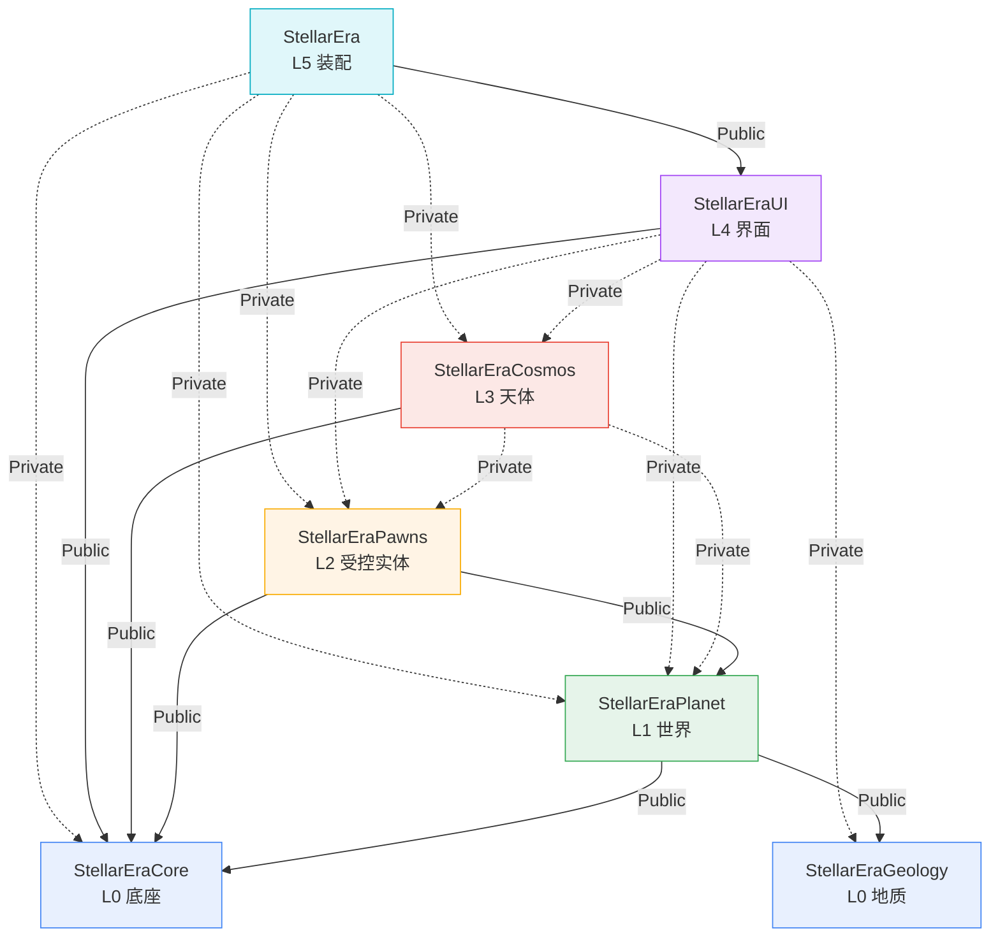

# StellarEra 架构

> 本文描述**已经实施**的架构，不是提案。
> 数字来自 2026-10-31 的源码统计，结构改动后请同步本文。
> 体检：`python Tools/check_architecture.py`（加 `--tree` 看分层）。

---

## 一、一页速查

7 个模块，6 层，135 个文件，37117 行，30 个自动化测试。

| 层 | 模块 | 文件 | 行数 | 测试 | 一句话 | 依赖（Public / Private） |
|---:|---|---:|---:|---:|---|---|
| L0 | `StellarEraCore` | 7 | 2687 | 1 | 单位系统、N 体求解器、跨模块接口 | 无项目依赖 |
| L0 | `StellarEraGeology` | 18 | 3175 | 1 | 元素表、地质场、矿物分布、预设 | 无项目依赖 |
| L1 | `StellarEraPlanet` | 59 | 15611 | 12 | 一颗行星的全部：地形 / 大气 / 矿物 / 编辑 | Public: Geology, Core |
| L2 | `StellarEraPawns` | 17 | 4460 | 7 | 玩家能 possess 的：角色、飞船 | Public: Core, Planet |
| L3 | `StellarEraCosmos` | 10 | 3695 | 2 | N 体编排与轨迹 | Public: Core / Private: Planet, Pawns |
| L4 | `StellarEraUI` | 16 | 4340 | 5 | HUD、星图、图例、星图相机 | Public: Core / Private: 其余功能模块 |
| L5 | `StellarEra` | 8 | 3149 | 2 | GameMode、PlayerController（primary game module） | Public: UI / Private: 其余 |

`StellarEra` 保留原名，所以 `IMPLEMENT_PRIMARY_GAME_MODULE` 不动，
`/Script/StellarEra.*` 路径不变，`DefaultEngine.ini` 与 `UniverseMap.umap` 里的引用无需改。

---

## 二、分层与依赖

层号 = 依赖深度，**不是目录**。全部模块平铺在 `Source/` 下。



实线是公开依赖，虚线是私有依赖（下游看不到被依赖模块的头）。

**单向，无环。** 两条曾经试图制造环的路，都留着明确的注释说明为什么没搬：

| 想搬的东西 | 会形成的环 | 现在的处理 |
|---|---|---|
| `AStarMapCameraPawn` → Pawns | `Pawns → Cosmos → Pawns`（Cosmos 有 4 处 `Cast<ASpaceshipPawn>`） | 相机留在 UI。等 `ICosmosBody` 抽出来再搬 |
| UI 直接用 `CosmosSimulationSubsystem` | 已经是合法方向（UI 在上层），无需搬 | UI 私有依赖 Cosmos |

### Public 还是 Private —— 判据只有一条

**看公开头**，不看 `.cpp`：

| 公开头里做了什么 | 依赖级别 |
|---|---|
| `#include` 了对方的头 | Public |
| 按值 / 按 `TWeakObjectPtr` 持有对方类型 | Public |
| 继承对方的类（如 `UDataAsset`） | Public |
| 只在 `.cpp` 里用，公开头里连前置声明都没有 | Private |

这条判据踩过坑：合并后 UI 失去了 Terrain 的 Public 传递依赖，链接期才报
`LNK2019: Z_Construct_UClass_UVoxelSimpleInvokerComponent`。**头能编过不代表链接能过**，
UBT 的 Public 依赖是传递的，Private 不是。

---

## 三、模块内布局

每个模块长得一模一样，只有四种东西：

```
StellarEraPlanet/
├── StellarEraPlanet.Build.cs       构建规则
├── StellarEraPlanet.h              模块入口（IMPLEMENT_MODULE）
├── StellarEraPlanet.cpp
└── Src/                            业务代码全在这里
    ├── VoxelPlanetActor.h/.cpp     头与源同目录并列
    ├── Terrain/  Surface/  Invokers/  Atmosphere/  Minerals/  Edit/
    └── Tests/                      *Tests.cpp 只放这里
```

三条规则：

1. **入口两件套与 `Build.cs` 并排**，不进 `Src/`。`Src/` 里只有业务代码。
2. **`.h` 与 `.cpp` 同目录**，改一个功能时不用两边跳。
3. **新增文件/目录不用登记**：`.cpp` 由 `UBT` 递归收集，include 路径由下面的循环递归添加，
   所以加子目录不需要改 `Build.cs`。唯一例外是**新增模块**，那要动 `Build.cs`、
   `.uproject`、两个 `Target.cs` 的四处。

```csharp
string SrcDir = Path.Combine(ModuleDirectory, "Src");
PublicIncludePaths.Add(ModuleDirectory);
PublicIncludePaths.Add(SrcDir);
foreach (string SubDir in Directory.GetDirectories(SrcDir, "*", SearchOption.AllDirectories))
    PublicIncludePaths.Add(SubDir);
```

`BuildSettingsVersion.V7` 下 `bLegacyPublicIncludePaths = false`，UBT **只认**
`Public/Private/Classes/Internal` 这四个目录名自动加路径（`UEBuildModuleCPP.cs:450-474`），
`Src/` 及子目录必须像上面这样显式加，否则 `#include "PlanetCharacter.h"` 立刻 C1083。

### 什么时候该建子目录

| 目录内文件数 | 动作 |
|---|---|
| ≤ 12 | 不拆。命名前缀（`PlanetMineral*`）已经够用 |
| 13–15 | 先问「有没有第二类职责」，有才拆 |
| ≥ 16 | 已过载，拆 |

拆分方式：**按「它回答什么问题」分，不按类名分**；拆完每族至少 4 个文件才值得单独开目录。

判归属**看 include 关系，不看文件名前缀**。例证：`Terrain/` 原来 18 个文件，
其中 4 个被 Pawns 与 UI 跨模块 include —— 它们是 Voxel 插件 LOD 的接线层，
不是地形，于是分出了 `Invokers/`。

当前各目录规模：`Terrain` 10、`Edit` 12、`Distributions`(Geology) 10、`Minerals` 8、
`Atmosphere` 5、`Invokers` 4、`Surface` 4、`UI/Src` 9、`Character` 6、`Cosmos/Src` 6。

### 搬目录为什么可以零代码改动

同时满足这两条时，搬子目录只需 `git mv` + 重编：

1. 全项目 include 都是**扁平写法**（`#include "PlanetSurfaceRay.h"`，不带目录前缀）
2. `Build.cs` 递归加 include 路径

2026-10-31 那次搬 18 个文件，git 全部识别为 `rename (100%)`，无一行内容变化。

---

## 四、通讯机制

只有三种通道，**没有事件总线**，也**刻意不引入**。

### 通道一：Pull —— HUD 每帧拉

UI 是 **Canvas 立即模式**（`AStellarEraHUD::DrawHUD` + `UStarMapUISystem` 全静态无状态绘制），
不是 UMG。所以按帧拉取，不做数据绑定：

```cpp
UCosmosSimulationSubsystem* Simulation =
    World ? World->GetSubsystem<UCosmosSimulationSubsystem>() : nullptr;
```

`UStarMapUISystem` 的方法全是 `static`，只吃参数、不持有状态 —— 因此它天然可测
（`Src/Tests/` 里直接调）。

> UMG 面板将来如果出现（工厂界面），那个局部可以上 MVVM。全局不适用。

### 通道二：Subsystem —— 跨帧状态的唯一归属

全项目**只有一个** Subsystem：`UCosmosSimulationSubsystem`（`UTickableWorldSubsystem`，
在 `StellarEraCosmos/Src/`）。

规则：**同一份状态活过两帧，就必须有唯一归属地。** 不许出现「A 组件缓存一份、B 组件也缓存一份」。

### 通道三：局部委托 —— 只用于「资产变更」这种低频通知

全项目只有 2 个：

| 委托 | 位置 | 用途 |
|---|---|---|
| `FOnPlanetGeologyPresetChanged` | `StellarEraGeology/Src/PlanetGeologyPreset.h` | 预设资产被改 |
| `FOnPlanetGeologyAssetChanged` | `StellarEraPlanet/Src/VoxelPlanetActor.h` | 行星引用的地质资产被换 |

都是编辑器里改资产时的刷新信号，不是运行时游戏逻辑的消息。

### 两个接口 —— 打破「实现方 ↔ 使用方」的互相依赖

| 接口 | 位置 | 为什么放这 |
|---|---|---|
| `IVoxelViewpointInvokers` | `StellarEraCore/Src/Interfaces/` | 实现方是 Pawns 的两个 Pawn，使用方是 Controller 与 UI。放任何一边都会让另一边被迫依赖 |
| `IStarMapUIInputs` | `StellarEraUI/Src/` | 明确属于 UI 的使用方契约，由 Controller（L5）实现 |

第二个是**有意的例外**：接口不一定都住 Core。判据是「这个契约属于谁」——如果是
某个使用方的输入需求，就跟着使用方走。

### 明确禁止

| 禁止 | 原因 |
|---|---|
| 事件总线 / 全局消息队列 | 单人项目，订阅关系一多就没人理得清；Pull 已经够用 |
| 全局单例 | Subsystem 就是 UE 给的单例，且带生命周期 |
| 功能模块 include UI 的头 | 反向依赖，`StellarEraUI.Build.cs` 头注释里写死了 |
| UI 依赖 `StellarEra`（primary game module） | Game 依赖 UI，UI 再依赖 Game 成环。要控制器数据就走 `IStarMapUIInputs` |

---

## 五、契约放在哪

| 东西 | 放哪 | 例 |
|---|---|---|
| 跨模块接口 | `StellarEraCore/Src/Interfaces/` | `IVoxelViewpointInvokers` |
| 跨模块 POD / 单位类型 | `StellarEraCore/Src/` | `CosmosTypes.h` |
| 使用方专属契约 | 使用方模块根 | `StellarEraUI/Src/StarMapUIInputs.h` |
| UE 资产预设 | 定义它的数据模块 | `UPlanetGeologyPreset` 在 Geology |
| 内部头（有实现细节） | 与实现同目录 | `PlanetProgressiveEditKernel.h` |

---

## 六、命名与导出

| 对象 | 规则 | 例 |
|---|---|---|
| 导出宏 | `<模块名大写>_API`，**与当前模块名一致** | `STELLARERAPLANET_API` |
| UCLASS | `U` / `A` / `F` / `I` 前缀 + 业务名 | `UVoxelPlanetGenerator` |
| 文件名 | 与主类同名，不加模块前缀以外的修饰 | `PlanetEditComponent.h` |
| 测试 | `*Tests.cpp`，类名 `F<被测>` + `Test` | `FPlanetSurfaceRayTest` |

> **导出宏最容易漏的地方**：模块合并后，从主线并进来的新代码常常还写着旧模块的
> `_API`（如 `STELLARERAPLANETEDIT_API`）。文件路径会被 git rename detection 带走，
> **宏不会**。合并后必须 `grep` 一遍旧模块名。

---

## 七、新增功能落位决策树

```
新代码要加在哪？
│
├─ 是「元素/矿物分布规则」？            → StellarEraGeology（纯数据 + 算法，无 Actor）
├─ 是「行星上的东西」（地形/大气/矿物/编辑/表面）？
│                                       → StellarEraPlanet/Src/<功能面>/
├─ 是「玩家能控制的东西」？              → StellarEraPawns/Src/<Character|Spaceship>/
├─ 是「天体运动 / 轨道 / N 体」？        → StellarEraCosmos
├─ 是「显示 / 交互」？                   → StellarEraUI
├─ 是「游戏框架 / 输入绑定 / 模式切换」？  → StellarEra（装配层）
└─ 是「跨模块契约」？
   ├─ 接口                             → StellarEraCore/Src/Interfaces/
   └─ 共用 POD                          → StellarEraCore/Src/
```

新模块**不要轻易加**。单人项目里模块化的收益（并行开发、二进制复用、流式加载）
接近零，成本（Build.cs 维护、环排查、跨模块 include 的隐性约束、导航时多找一层）
每天都要付。

---

## 八、红线

1. `*Tests.cpp` **只能出现在 `Src/Tests/`**。测试放哪个模块看它 include 了谁 ——
   必须是所引头文件的下游。跨模块集成测试放 `StellarEra/Src/Tests/`。
2. **不许往 `Src/` 根堆文件**。那一层只留模块门面（如 `VoxelPlanetActor.h`）。
3. **不许出现依赖环**。想搬某个类而产生环时，先抽接口，不要硬搬。
4. **`Config/DefaultEngine.ini` 的 `[CoreRedirects]` 不要删**。36 条历史类路径靠它兜底，
   删了蓝图父类和 `.umap` 里的引用会断。
5. **`Plugins/VoxelFree` 与 `Plugins/VibeUE` 是第三方，不要改。**

---

## 九、构建与验证

```bash
# 编译（本机必须带 -NoUBA，原因见 docs/BUILD_NOTES.md）
"D:/Application/Epic Games/UE_5.8/Engine/Build/BatchFiles/Build.bat" \
  StellarEraEditor Win64 Development \
  -Project="F:/workspace/ue/StellarEra/StellarEra.uproject" -WaitMutex -NoUBA

# 架构体检
python Tools/check_architecture.py
python Tools/check_architecture.py --tree
```

体检覆盖：依赖环、超大文件、跨模块 include ≥6、测试是否散落、纯逻辑模块是否暴露表现层基类。

**当前基线**：依赖环 / 测试散落 / 跨模块 include ≥6 / 分层倒挂 —— **全空**。
只有「超大文件」有提示（3 个 `.cpp` 超 600 行、8 个 `.h` 超 300 行），
属于正常的体积信号，不是违规：`SpaceshipPawn.h` 942 行是因为它的属性配置段本来就长。

本机的 `LNK1201 / LNK1136` 是安全软件拦 `Binaries/` 目录写入导致的，
必须做 `Binaries → BinariesReal` 目录联接。步骤记在 `docs/BUILD_NOTES.md`。

---

## 十、历史沿革

| 时间 | 变化 | 记录 |
|---|---|---|
| 重构前 | 11 模块、8 层，测试散在各模块 `Private/` | — |
| 2026-10-31 | **11 → 7 合并**：Terrain+Atmosphere+Minerals+PlanetEdit → Planet；Character+Spaceship → Pawns | `docs/TREE_AFTER.md` |
| 同日 | 取消 `Public/Private` 分层，改为 `Src/` 内头源同目录 | 同上 |
| 同日 | 并入主线在此期间开发的 8 个行星编辑提交（git 重命名检测全自动映射） | 提交 `3c016bd` |
| 同日 | 过载目录细分：`Terrain` 18 → 10/4/4，Geology 拆 `Distributions/` | 提交 `967135a` |

被推翻的方案保留在 `docs/archive/`（17 模块方案），**已标注作废，不要参照实现**。

---

## 相关文档

| 文档 | 内容 |
|---|---|
| `Source/README.md` | 按层导读 + 「改 X 看哪个文件」索引（最常翻） |
| `CLAUDE.md` | 给 AI 助手看的模块结构与硬规则 |
| `docs/TREE_AFTER.md` | 11 → 7 合并的完整推演与当前文件树 |
| `docs/BUILD_NOTES.md` | 本机构建坑（pdb 写入失败、UBA） |
| `docs/archive/` | 作废方案，仅存档 |
